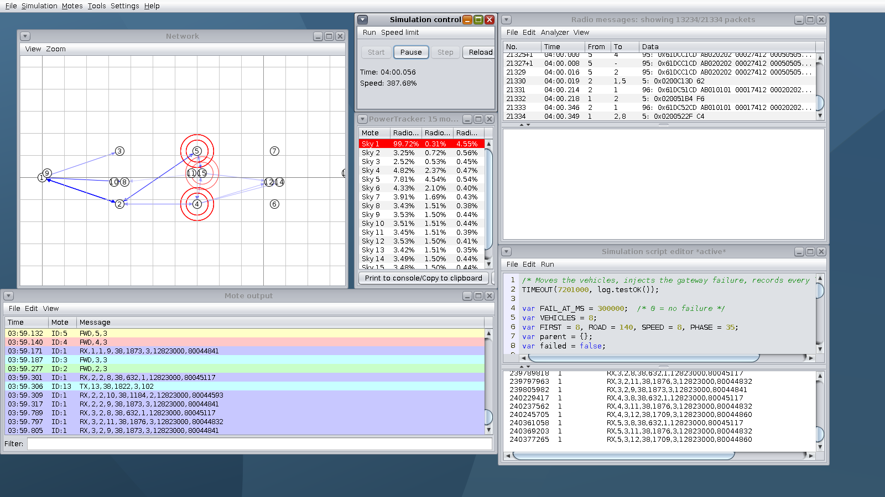
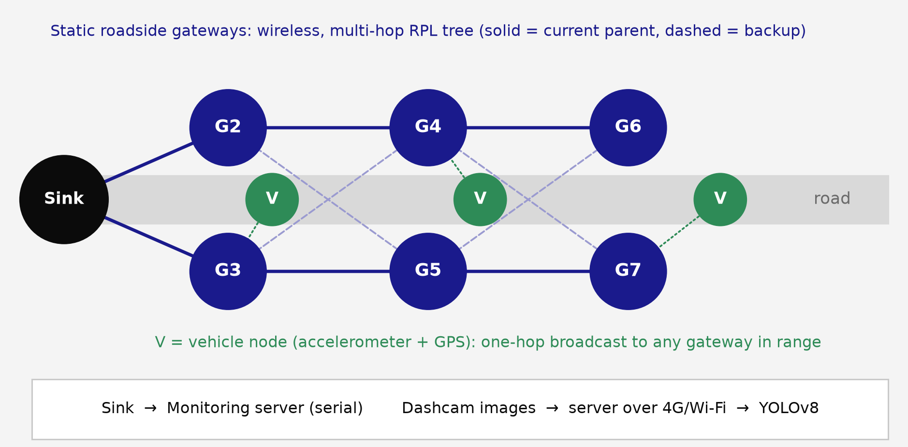
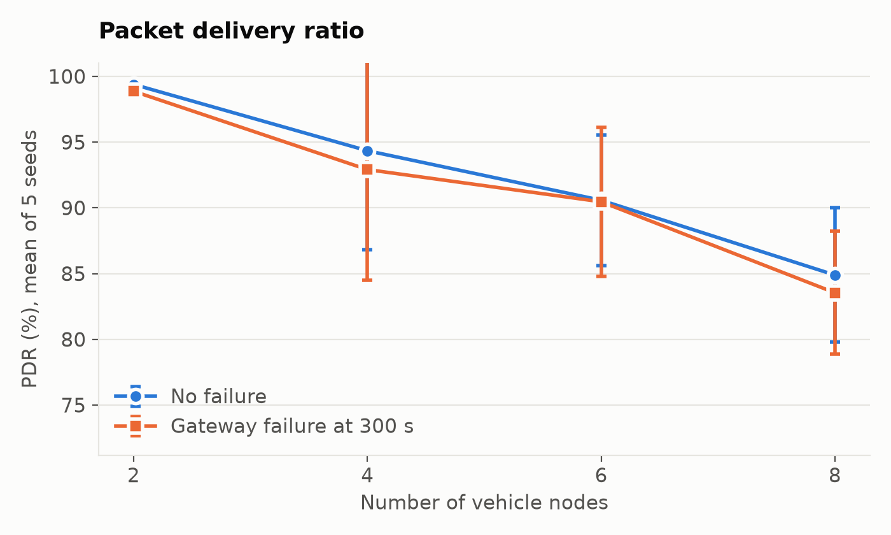

# WSN-Based Road Pothole Detection and Priority Monitoring

A wireless sensor network, simulated in **Contiki 3.0 / Cooja**, in which vehicles report road damage through a redundant roadside network to a sink. A server then combines those reports with **YOLOv8** image detection to rank potholes for repair.

Subject project for Wireless Sensor Networks. Harsh Gupta (RA2311003010866), Debabrata Bhattacharya (RA2311003010892).



---

## Highlights

- **Simulated on emulated hardware:** real Contiki firmware running on Tmote Sky motes in Cooja, with moving vehicles.
- **Redundant roadside network:** six paired gateways form a multi-hop RPL tree, so losing one doesn't disconnect the nodes behind it.
- **Measured over 40 runs:** PDR of 84.9-99.4%, mean delay under 1.4 s, and recovery from a gateway failure in every failure run.
- **Machine learning on real images:** YOLOv8s reaches mAP@50 of 0.93 on held-out pothole images.
- **Repair prioritisation:** network reports and image detections are combined into a ranked list of repair sites.

Full write-ups are in [`deliverables/`](deliverables/): a [project report](deliverables/WSN_Pothole_Project_Report.pdf) and a presentation.

---

## How the system works



| Node | IDs | Role |
|---|---|---|
| Sink | 1 | RPL root, radio always on, logs every report for the server |
| Roadside gateways | 2-7 | Static RPL routers in redundant pairs; remove duplicates; batch up to 3 reports or flush after 2 s |
| Vehicles | 8-15 | Sample vibration at 10 Hz, send one report per 5 s window as a one-hop broadcast; RPL is compiled out |

**Data path:** vehicle → one-hop broadcast → nearest gateways → multi-hop RPL tree → sink → monitoring server. Dashcam images reach the server separately over 4G/Wi-Fi, where YOLOv8 runs.

### Design decisions

| Decision | Reason |
|---|---|
| **RPL, not AODV** | The gateway backbone is static and all traffic goes to one sink, which is what RPL's tree is built for. Contiki 3.0's IPv6 stack has RPL but no AODV. |
| **Vehicles are not routers** | RPL handles moving routers badly. Contiki 3.0's leaf mode doesn't actually stop a node advertising routes (gateways really did pick moving vehicles as parents in testing), so RPL is compiled out of the vehicle firmware. |
| **Six paired gateways, all wireless** | A single gateway would leave no alternate route, so one failure would cut off every node behind it. |
| **Images do not cross the WSN** | 802.15.4 frames carry at most 127 bytes, while YOLOv8 needs full images that vibration and GPS reports can't provide. |

---

## Results

40 Cooja runs: 2, 4, 6 and 8 vehicles, each with and without a gateway failure at 300 s, 5 random seeds each, 600 simulated seconds per run. Values are means.

| Vehicles | PDR, no failure | PDR, with failure | Delay, no failure | Hops | Throughput | Slowest re-parent after failure |
|---|---|---|---|---|---|---|
| 2 | 99.4% | 98.9% | 1.36 s | 2.39 | 47 bit/s | 6.6 s |
| 4 | 94.3% | 92.9% | 0.80 s | 2.38 | 90 bit/s | 6.9 s |
| 6 | 90.6% | 90.5% | 0.79 s | 2.35 | 130 bit/s | 7.1 s |
| 8 | 84.9% | 83.5% | 0.77 s | 2.24 | 162 bit/s | 5.4 s |



**How to read them**

- **PDR falls as vehicles increase** because vehicle broadcasts compete for the channel and have no acknowledgement or retransmission.
- **Delay is highest with 2 vehicles**, which is consistent with gateways more often waiting for the 2 s batch timer when traffic is light.
- **A gateway failure costs at most 1.4 PDR points**, which is within the variation between seeds at 4-8 vehicles, so it is not a statistically clear loss.
- **All 20 failure runs recovered.** The children of the removed gateway chose a new parent.

**Power and estimated lifetime (2 x AA, 2500 mAh):** vehicles 2.06-2.33 mW (134-152 days); gateways 1.97-3.03 mW (103-159 days); the sink about 60 mW, assumed mains powered.

### YOLOv8

YOLOv8s, 120 epochs, on 582 training, 157 validation and 80 held-out test images.

| Precision | Recall | mAP@50 | mAP@50-95 |
|---|---|---|---|
| 0.929 | 0.897 | 0.930 | 0.790 |

### Repair ranking

The server clusters reports from an 8-vehicle run by road position and scores each site: vibration 30%, image-estimated size 25%, confidence 10%, traffic 20%, road importance 15%. All five simulated potholes were located.

| Rank | Position | Segment | WSN severity | YOLO size | Score |
|---|---|---|---|---|---|
| 1 | 47.9 m | Market road | High | Small | 75.7 |
| 2 | 102.9 m | Residential | High | Large | 74.5 |
| 3 | 77.0 m | Market road | Low | Medium | 65.9 |
| 4 | 125.0 m | Residential | Medium | Large | 65.9 |
| 5 | 21.0 m | School zone | Medium | Small | 64.6 |

---

## Limitations

- **Vibration and GPS are synthetic.** Cooja has no road or GPS. The sampling, detection, networking and routing code does run on emulated Sky motes.
- **The ranking uses assumed inputs:** which image belongs to which site, and the traffic and road-importance values, are illustrative.
- **AODV was not simulated.** The comparison is qualitative, so no measured advantage is claimed.
- **Battery lifetime is calculated** from duty cycle and Sky current figures, not measured.
- **UDGM is an idealised radio model** (50 m range, 90% receive success).

---

## Running the demo

**Requirements:** Windows with WSL, or Ubuntu 20.04.

### First-time setup

```
wsl --install -d Ubuntu-20.04
```

Clone this repo, then from a Windows terminal in the repo folder:

```
wsl -d Ubuntu-20.04 -u root -- bash setup_wsl.sh
wsl -d Ubuntu-20.04 -u wsn -- bash sync.sh
```

`sync.sh` copies the firmware into Contiki and compiles it.

### Start it

Double-click `run_demo.bat` (gateway failure at 5:00), or run `run_demo.bat baseline` (no failure).

Keep the black window open. After about 25 seconds, Cooja opens in a browser tab at `http://localhost:6080/vnc.html`. The browser is used because WSLg did not draw Cooja's window on the laptop this was built on.

Click **Start** in **Simulation control**. Speed limit in the same panel runs it faster. The simulation pauses itself at 6:30; click **Start** to continue.

| Sim time | What happens | Where to look |
|---|---|---|
| 0:00-1:00 | Gateways join the RPL tree | Mote output: `PARENT,4,2` |
| From 1:00 | Vehicles report | `TX`, `FWD`, `RX` lines; arrows in Network |
| 5:00 | One first-tier gateway is removed | Network; PowerTracker shows 14 motes |
| Seconds later | Its children switch parent | `PARENT` lines (type `PARENT` in Filter) |
| 6:30 | Simulation pauses | Simulation control |

For a manual failure, open the baseline demo and right-click a gateway (2-7), then **Remove**.

### Log format

| Line | Fields |
|---|---|
| `TX` | vehicle, seq, peak mg, severity, x metres |
| `FWD` | gateway, records sent |
| `RX` | via node, hops, vehicle, seq, peak mg, severity, lat e6, lon e6 |
| `PARENT` | gateway, parent (0 = none) |
| `ENERGY` | node, CPU, LPM, TX, RX ticks |

---

## Reproducing the results

Simulation, inside Ubuntu-20.04 from this folder:

```
bash sync.sh
bash simulation/run_all.sh    # 40 runs, written to results/raw
```

Analysis, in Python with `pandas`, `matplotlib`, `ultralytics`, `reportlab`:

```
python analysis/analyze.py        # summary.csv and charts
python analysis/make_figures.py   # slide diagrams
python analysis/make_report.py    # report PDF
```

`ml/train_yolo.py`, `ml/evaluate.py`, `ml/priority.py` and `analysis/update_ppt.py` have paths from the original laptop near the top of each file, so change those first. `update_ppt.py` also needs the original deck, which isn't in this repo.

## Repository layout

```
firmware/        sink.c, gateway.c, vehicle/vehicle.c (Contiki 3.0)
simulation/      demo .csc files, .csc generator, batch runner
analysis/        metrics, charts, diagrams, report and deck builders
ml/              YOLOv8 training, evaluation, priority ranking, trained weights
results/         raw logs, metrics, charts, figures, screenshots
deliverables/    presentation and report
run_demo.bat     starts the demo
demo_vnc.sh      runs Cooja on a virtual display, served to the browser
setup_wsl.sh     installs Contiki, Cooja and the demo tools
sync.sh          copies firmware into Contiki and builds it
```

## Credits

- Pothole images: [manot/pothole-segmentation](https://huggingface.co/datasets/manot/pothole-segmentation) (Roboflow export, CC BY 4.0). The dataset is not stored here; `ml/train_yolo.py` downloads it.
- [Contiki OS](https://github.com/contiki-os/contiki) and Cooja.
- [Ultralytics YOLOv8](https://github.com/ultralytics/ultralytics).
